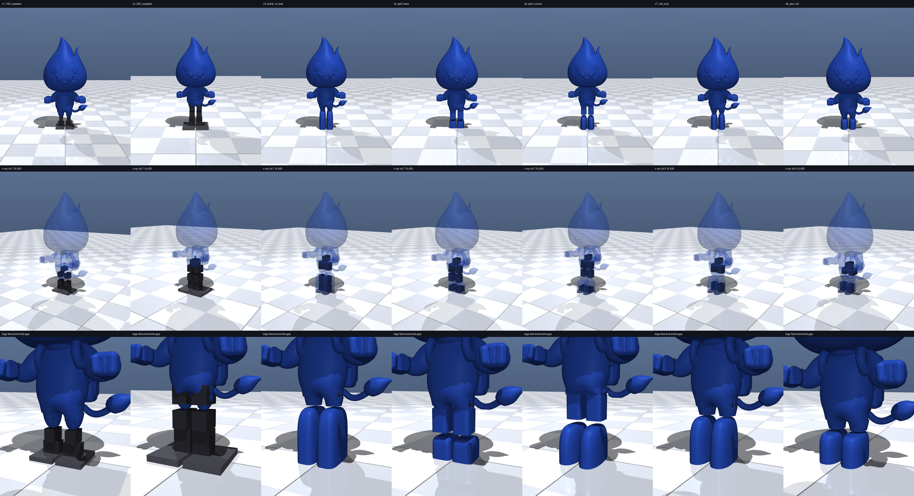

# 횃불이 이족보행 로봇 — URDF / MuJoCo 모델

횃불이 캐릭터 STL을 관절 단위로 잘라 서보로 움직이는 이족 로봇 모델로 만든다.
버전마다 `robot/<버전>/`에 따로 생성된다. 현재 기준 모델은 `v22_sts3032`.



## 현재 기준 모델: v22_sts3032

| 항목 | 값 |
|---|---|
| 관절 | 고관절 피치 ×2, 발목 피치 ×2, 발목 롤 ×2 (Feetech STS3032, 모두 외피 안) |
| 크기 / 질량 | 전고 511 mm / 2.04 kg, 무게중심 높이 177 mm (다리 중심선보다 4 mm 앞) |
| 외피 | 몸통·팔·백팩·다리·발 4 mm, 머리·꼬리 2 mm, 모터와 겉면 사이 4 mm |
| 디스플레이 | 7인치 휴대용 모니터 (152 g, 175.5 × 98.5 × 9.4 mm) |
| 몸통-다리 | 몸통을 고관절 회전 중심 높이에서 자르고 다리를 소켓에 끼움, 다리 윗부분은 회전 중심 둘레 돔 |
| 전장품 | 배터리·드라이버·Pi·레귤레이터 모두 등 쪽 (`electronics.json`, `layout_xray.png`) |
| 보행 | 12초 244 mm, 32초 609 mm 직진 (IMU 되먹임, 다리-몸통 충돌 검사 포함) |
| 부하 (최대 / 평균, STS3032 대비) | 발목 피치 60 / 21 %, 발목 롤 55 / 24 %, 고관절 피치 34 / 17 % |

## 버전

보행 거리는 12초 기준. 부하 판정은 최대 70 %, 평균 35 % 이하(스톨 대비).
v15_w4 이후는 서 있기·데모에도 IMU 되먹임을 켠 기준으로 계산했다.

| 버전 | 구성 | 전고 | 질량 | 결과 |
|---|---|---|---|---|
| `v1_700_exposed` | XL430 7개, 발목 모터를 다리 아래에 쌓아 노출 | 700 mm | 3.43 kg | 한 발 지지 됨 |
| `v2_500_exposed` | v1을 500 mm로 | 500 mm | 2.08 kg | 한 발 지지 됨 |
| `v3` | 도라에몽 발 시안 (`modelings/haetburi_feet_v1.stl`) | - | - | 모델 아님 |
| `v4_ankle_in_foot` | 발목 모터 2개 모두 발 속 | 608 mm | 2.83 kg | 한 발 지지 됨 |
| `v5_split_boxy` | 롤은 다리, 피치는 발, 각진 발 | 584 mm | 2.69 kg | 한 발 지지 됨 |
| `v6_split_round` | v5 + 둥근 앞발, 반바지 몸통 | 614 mm | 2.82 kg | 한 발 지지 안 됨 |
| `v7_roll_only` | 발목 피치 제거 (모터 5개) | 581 mm | 2.62 kg | 146 mm |
| `v8_yaw_roll` | 고관절 요 + 발목 롤 (Otto 방식) | 546 mm | 2.59 kg | 445 mm |
| `v9_yaw_roll_display` | v8 + 9인치 디스플레이 | 546 mm | 3.25 kg | 419 mm |
| `v10_split_display` | 다리당 3관절 + 디스플레이 | 586 mm | 3.41 kg | 186 mm, 직진 |
| `v11_newbase_display` | 새 캐릭터 STL, 롤 모터 STL 발 속 | 727 mm | 4.42 kg | 176 mm |
| `v12_slipper_display` | 발목 롤 노출, 슬리퍼형 발 | 526 mm | 2.87 kg | 342 mm |
| `v13_ankle_pitch_display` | v11 + 발목 피치를 다리 속에 쌓기 | 769 mm | 4.75 kg | 62~131 mm |
| `v14_*` | v12 구조 축소, 허리 고정 (모터 4개): XC330 / XL330 / STS3032 / SCS0009 | 238~323 mm | 0.34~0.83 kg | 231~336 mm |
| `v14_*_hidden` | 모터 전부 몸 안 | 391~525 mm | 1.15~2.75 kg | 155~328 mm |
| `v15_*` | v14 hidden + 발목 피치 (다리 속), 다리 앞으로 11~13 mm | 463~559 mm | 1.72~2.86 kg | 91~272 mm |
| `v16_*` | 발목 모터 2개를 STL 발 속에, 다리 원형 유지 | 524~871 mm | 2.56~10.3 kg | 대부분 못 걸음 (토크 부족) |
| `v17_*` | 발목 피치 대신 고관절 피치, 다리-배 구면 이음매 | 391~525 mm | 1.27~2.75 kg | 166~352 mm |
| `v18_*` | 다리를 가랑이에서 분리, 배 아랫면을 다리 궤적만큼 파냄 | 391~525 mm | 1.28~2.78 kg | 모델링만 |
| `v19_*` | PartsAssemblyV2식 소켓 (고관절 요+피치), 4 mm 벽 | 466~598 mm | 2.02~3.39 kg | STS3032 154 mm (고관절 피치 77 %, 과부하) |
| `v20_*` | 고관절 피치 + 발목 피치 + 발목 롤, 소켓 | 511~634 mm | 2.48~3.57 kg | STS3032 119 mm, 부하 정상 |
| `v21_*` | v20 + 곧은 다리, 다리를 덮도록 몸통 아랫부분 재구성 | 511~634 mm | 2.44~3.50 kg | STS3032 121 mm, 부하 정상 |
| `v21_sts3032_lite` | v21 + 가벼운 디스플레이 패널 | 511 mm | 2.09 kg | 179 mm, 여유 큼 |
| **`v22_sts3032`** | v21 + 실제 7인치 모니터, 전장품 자동 배치 | 511 mm | 2.04 kg | **244 mm, 여유 큼** |
| `*_w4` | v14~v17 STS3032 모델에 4 mm 벽 적용 | 283~610 mm | 0.74~3.27 kg | v14 계열만 부하 정상 |
| `v14_sts3032_hidden_7in` | v14 hidden w4 + 7인치 모니터 (모터 4개) | 470 mm | 1.65 kg | 278 mm, 몸 비틀며 걸음 (요 흔들림 33°) |

## 사용법

```
HAETBURI_VARIANT=v22_sts3032 python3 tools/build_model.py      # 한 버전 빌드
MUJOCO_GL=egl python3 tools/build_all.py                        # 전 버전 빌드·분석·렌더
python3 tools/place_electronics.py v22_sts3032 [--body-only]    # 전장품 배치
python3 tools/mass_breakdown.py v22_sts3032                     # 질량 분해
MUJOCO_GL=egl python3 tools/render_layout.py v22_sts3032        # 부품 배치 투시도
MUJOCO_GL=egl python3 tools/render_hip_seam.py v22_sts3032      # 몸통-다리 이음매, 고관절 가동 범위

python3 sim/walk.py --variant v22_sts3032 --search --fb 0.3,0.2,0.03   # 보행 탐색 (IMU 되먹임)
python3 sim/walk.py --variant v22_sts3032 --refine                      # 최적 보행 주변 정밀 탐색 + 32초 검증
python3 sim/loads.py --variant v22_sts3032                              # 관절 부하
MUJOCO_GL=egl python3 sim/walk.py --variant v22_sts3032 --video robot/v22_sts3032/walk.mp4
python3 sim/play.py --variant v22_sts3032                               # 뷰어에서 직접 걷기
```

`WALK_PROCS`로 보행 탐색 프로세스 수를 제한한다 (프로세스당 약 0.7 GB).

`sim/play.py` 키: ↑↓ 주파수, →← 고관절 스윙, PgUp/PgDn 발목 롤, Insert same/anti, Home 걷기/서기, End 리셋.

## 파일

```
tools/haetburi_params.py     버전 목록(VARIANTS)과 치수·질량·관절 범위·서보 사양
tools/build_model.py         빌드: URDF, MJCF, 메시, build_report.txt, 고관절 충돌 범위(hip_range.json)
tools/newbase.py             새 캐릭터 STL 처리: 복셀 솔리드, 모터 맞춤, 이음매·소켓·몸통 재구성
tools/make_display_model.py  캐릭터에 꼬리·디스플레이 결합
tools/place_electronics.py   전장품 자동 배치 (electronics.json)
tools/mass_breakdown.py      질량 분해
tools/render_*.py            미리보기, 이음매, 부품 배치, 비교 이미지
sim/walk.py                  열린 루프 보행 탐색·정밀 탐색·영상, 다리-몸통 충돌 검사
sim/balance.py               IMU 되먹임 균형 (피치: 발목 또는 고관절, 롤: 발목)
sim/loads.py                 관절 부하 (서기·최적 보행·기준 보행·데모)
sim/play.py                  대화형 뷰어
robot/<버전>/                생성물: 모델, 보고서, 미리보기, 보행·부하 결과
archive/                     이전 작업 기록
```

`robot/` 아래는 생성물이다. 파라미터를 고친 뒤 다시 빌드한다.

## 좌표계와 단위

- +x 정면, +y 로봇 왼쪽, +z 위, 발바닥 z = 0
- 메시·URDF·MJCF는 미터, 파라미터는 mm (새 캐릭터 내부 좌표는 STL 단위)

## 모델링 단순화

- 모터는 실제 치수·축 위치의 박스. 전장품은 실제 크기 박스의 질량점.
- 서보는 위치 제어 액추에이터 (kp, kv, 토크 한계는 스톨 토크 비례). PID·전류 제한은 미반영.
- 외피 질량은 면적 × 벽 두께 × 보강 계수 1.25 × PLA 밀도.
- 다리-몸통 접촉은 MuJoCo 볼록 형상으로 표현할 수 없어, 실제 부피로 충돌 범위를 계산해 관절 한계와 보행 탐색에 반영한다. 나머지 접촉은 MuJoCo가 계산한다.
- 보행은 사인파 걸음새 + IMU 되먹임. 강화학습 정책을 전제로 하며 물리적 토크 여유로 판단한다.

## 참고

- [ROBOTIS XL430-W250-T](https://emanual.robotis.com/docs/en/dxl/x/xl430-w250/), [XC330-T288](https://emanual.robotis.com/docs/en/dxl/x/xc330-t288/)
- [Feetech STS3032](https://robotdoo.com/products/feetech-sts3032-360-degree-serial-bus-servo)
- [PeakDo 7인치 모니터](https://www.newegg.com/p/3C6-00S7-00B69), [Wisecoco 7인치 (외곽 치수)](https://www.wisecocodisplay.com/product/7-inch-1080p-portable-monitor-19201080-fhd-ips-touch-screen/)
- `images-modeling/PartsAssembly.png`, `images-modeling/PartsAssemblyV2.jpeg`
